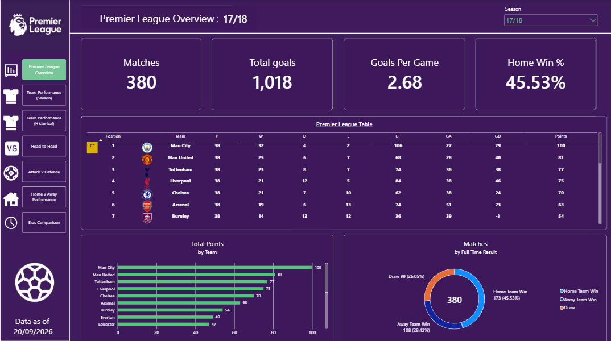
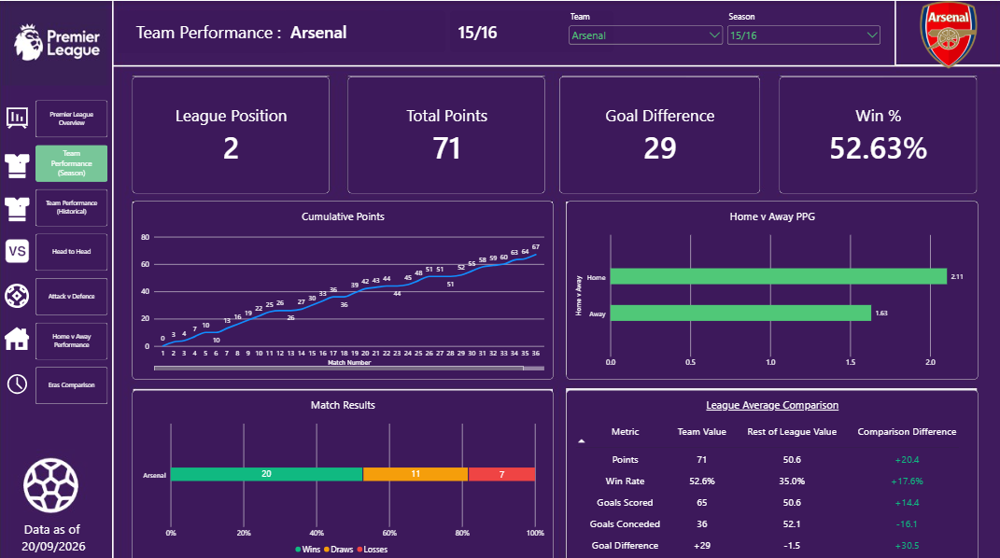
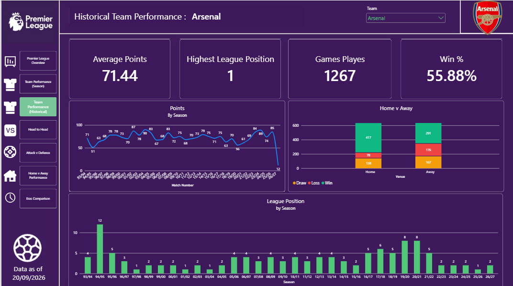
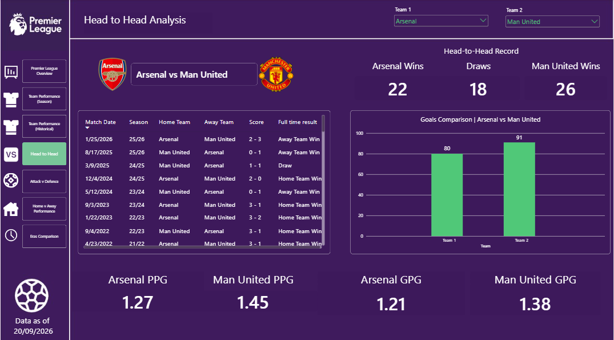
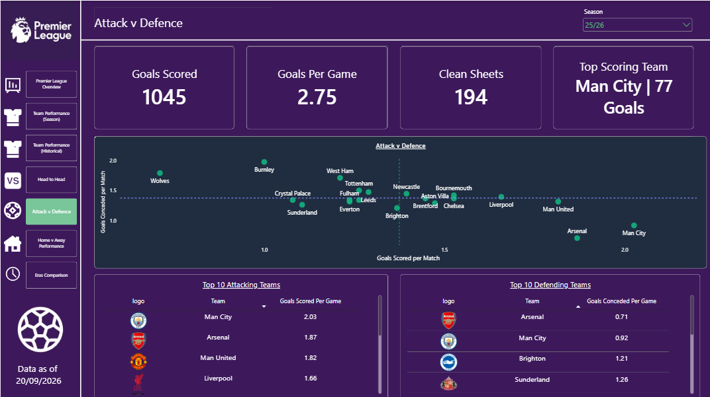
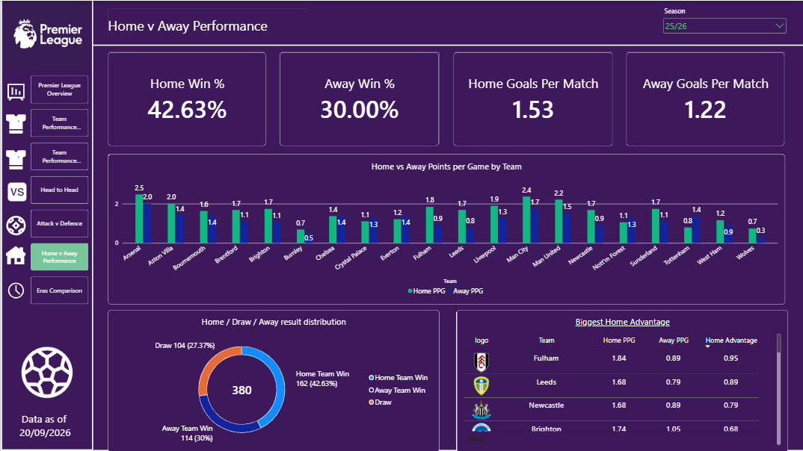
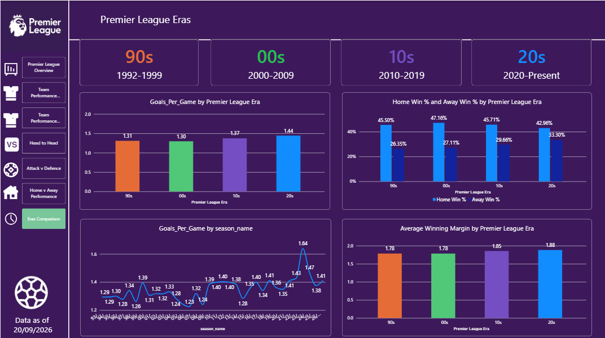

# ⚽ Premier League Analytics | SQL Server & Power BI

An interactive football analytics project exploring Premier League team performance, match results, head-to-head records, home advantage, and trends across the **1990s, 2000s, 2010s, and 2020s**.

The project combines **SQL Server**, **Power BI**, and **DAX** to transform historical match data into a report designed for comparison, exploration, and data storytelling.

> **Data coverage:** 1993-2026 (20/09/2026). The report reflects the seasons available in the source data; it may not include every Premier League season.


## Dashboard Preview



[View the Interactive Power BI Dashboard](https://app.powerbi.com/view?r=eyJrIjoiMzQ2MWJkNjctMjE1Ny00ZTUxLWFkMWUtYmZhOTIyODNkZGYwIiwidCI6IjViZjI2ZTU2LTUyNDQtNDQ2Zi1iZWQ5LTU1OGM1ZDAwNTk1ZSJ9)

## Project objectives

This project aims to answer questions such as:

- How do team standings and performance change across seasons?
- How do individual clubs compare on points, wins, goals scored, and goals conceded?
- What do historical head-to-head records reveal about two selected clubs?
- Which teams combine strong attacking output with solid defensive performance?
- How do clubs perform at home compared with away?
- How have goals per match, match outcomes, and winning margins changed across Premier League eras?

## Tools and technologies

| Tool | Purpose |
| --- | --- |
| **SQL Server / T-SQL** | Store, prepare, and structure match and team-season data |
| **Power BI** | Data modelling, interactive report development, and visualisation |
| **DAX** | Measures for points per game, goals per game, head-to-head records, and historical comparisons |
| **Power Query** | Data loading and preparation within Power BI, where applicable |

## Data model

The report uses a model centred on match-level and team-season-level data:

| Table | Description |
| --- | --- |
| `match_results` | Match results, dates, season IDs, home and away team IDs, and goals |
| `season_analysis` | Aggregated team performance by season, including points, results, and goals |
| `dim_team` | Team identifiers, names, and logo URLs |
| `dim_season` | Season identifiers, names, and era classifications |

The season dimension supports season-level filtering. Team and season dimensions support analysis of the team-season fact table. Match-level comparisons require additional care because **each match has both a home team and an away team**.


## Dashboard walkthrough

### 1. League Overview


Provides an overview of league performance for a selected season, including standings and headline team statistics. Season filters allow users to compare different campaigns.

### 2. Team Performance — Season



Allows users to select a club and season to explore points, wins, goals, goal difference, and performance over the course of that campaign.

### 3. Team Performance — Historical



Explores a selected club's performance across multiple seasons to identify longer-term changes and trends.

### 4. Head-to-Head Analysis



Compares two independently selected clubs using historical fixtures, wins, draws, goals, points per game, and goals per game. Dynamic titles and team logos make the comparison update with the selections.

### 5. Attack vs Defence



Compares attacking and defensive performance using goals scored and conceded per match, helping identify teams with different performance profiles.

### 6. Home vs Away Performance



Examines the difference between home and away results, including points earned and points per game. Calculations account for the actual number of completed matches played at each venue.

### 7. Premier League Eras



Groups seasons by their starting year into the **90s**, **00s**, **10s**, and **20s** to compare goals per match, home and away win rates, and average winning margins. This supports fairer historical comparisons than relying only on raw totals.

## Example DAX calculations

### Points per game

```dax
Points per game = divide([Total Points],([TOTAL WINS]+[TOTAL DRAWS]+[TOTAL LOSSES]) )
```

### Goals per match

```dax
Goals_Per_Game = sum('Season Analysis'[GoalsFor])/sum('Season Analysis'[Played])
```
### Average winning margin

```dax
Average Winning Margin = 
AVERAGEX(
    FILTER(
        'MATCH_RESULTS',
        'MATCH_RESULTS'[full_time_result] IN {"H", "A"}
    ),
    ABS(
        'MATCH_RESULTS'[home_goals] -
        'MATCH_RESULTS'[away_goals]
    )
)
```

The winning-margin measure includes **home and away victories**, while excluding draws.

## Technical challenges and solutions

### Handling home and away teams

**Challenge:** A match has two team IDs, so filtering on only the home-team relationship can accidentally exclude away fixtures. This complicates team-specific match histories and head-to-head analysis.

**Approach:** Use calculations that explicitly account for home and away roles, alongside team and season dimensions. Independent team selectors support comparisons between two clubs without one selection overriding the other.

### Building comparable metrics

**Challenge:** Raw totals can be misleading when seasons have different numbers of matches or when a season is incomplete.

**Approach:** Use normalised measures such as **points per game** and **goals per match**, and calculate home/away points per game from completed fixtures.

### Comparing football eras

**Challenge:** Season labels such as `95/96` and `03/04` need consistent chronological grouping.

**Approach:** Derive the season start year and assign seasons to the 90s, 00s, 10s, or 20s. A separate numeric sort column ensures eras appear in chronological order.

## Key findings

Add **three verified findings** from your completed report. For example:

1. **Scoring trends:** Goals per game increased by 9.92% between 90s era and 20s era.
2. **Home advantage:** Away win % increased by 26.86% between 90s era and 20s era.
3. **Winning margins:** Winning margin average has increased from 1.78 to 1.88 between 90s era and 20s era.


## Data quality and limitations

- **Season coverage:** The dataset may not contain every season since the Premier League began. The earliest available season should be clearly identified.
- **Incomplete campaigns:** Results and aggregates can change for seasons that are still in progress.
- **Historical comparability:** Match totals vary across seasons, so per-match measures are preferred for many era comparisons.
- **Available attributes:** Some historical data sources contain fewer fields than more recent seasons.
- **Data accuracy:** Results and calculations depend on the completeness and consistency of the underlying source files.

## Repository structure

A suggested organisation for the repository:

```text
The-Premier-League-30-Years-of-Football-Data/
├──  README.md
|
├── 01_Raw Data
|  ├── 00_01.xlsx
|  ├── 01_02.xlsx
|  ├── 02_03.xlsx
|  ├── 03_04.xlsx
|  ├── 04_05.xlsx
|  ├── 05_06.xlsx
|  ├── 06_07.xlsx
|  ├── 07_08.xlsx
|  ├── 08_09.xlsx
|  ├── 09_10.xlsx
|  ├── 10_11.xlsx
|  ├── 11_12.xlsx
|  ├── 12_13.xlsx
|  ├── 13_14.xlsx
|  ├── 14_15.xlsx
|  ├── 15_16.xlsx
|  ├── 16_17.xlsx
|  ├── 17_18.xlsx
|  ├── 18_19.xlsx
|  ├── 19_20.xlsx
|  ├── 20_21.xlsx
|  ├── 21_22.xlsx
|  ├── 22_23.xlsx
|  ├── 23_24.xlsx
|  ├── 24_25.xlsx
|  ├── 25_26.xlsx
|  ├── 26_27.xlsx
|  ├── 93_94.xlsx
|  ├── 94_95.xlsx
|  ├── 95_96.xlsx
|  ├── 96_97.xlsx
|  ├── 97_98.xlsx
|  ├── 98_99.xlsx
|  ├── 99_00.xlsx
|  ├── Power Query.txt
|
├── 02_Clean Data
|   ├── AllMatchData.csv
|   ├── AllMatchData.xlsx
|
├── 03_SQL
|   ├── Database Diagram.png
|   ├── FACT_MATCH Insert.sql
|   ├── Match Results.SQL
|   ├── Season Analysis.sql
|   ├── Team Match.sql
|   ├── Team Season Insert.sql
|
├── 04_Excel
|   ├── AllMatchData.xlsx
|
├── 05_Power Bi
|   ├── Premier League.pbix
|   ├── premier-league-logo-symbol-with-name-white-design-england-football-european-countries-football-teams-illustration-free-vector.jpg
|   ├── Premier-League-Logo.png
|
├── 06_Screenshots
|   ├── Page_1_Premier_League_Overview.png
|   ├── Page_2_Team_Performance_Season.png
|   ├── Page_3_Team_Performance_Historical.png
|   ├── Page_4_Head_to_Head.png
|   ├── Page_5_Attack_v_Defence.png
|   ├── Page_6_Home_v_Away_Performance.png
|   ├── Page_7_Era_Comparison.png
|   ├── Power BI Data Model.png
```


## How to explore the project

1. Review the dashboard screenshots in the `06_Screenshots/` folder.
2. Open the interactive report using the link above, if public access is enabled.
3. Explore the SQL scripts to understand the data preparation and modelling approach.
4. If the `.pbix` file is shared, open it in Power BI Desktop. A local SQL Server connection may need to be reconfigured before refreshing data.

## Future improvements

- Add additional verified historical seasons where data is available.
- Expand team-level analysis with more detailed statistics where source coverage permits.
- Improve tooltips, navigation, and accessibility throughout the report.
- Automate data refresh if a suitable maintained data source becomes available.

## Data source and acknowledgements

**Data source:** https://football-data.co.uk/englandm.php

**Project:** Personal data analytics portfolio project.

---

*Built with SQL Server, Power BI, and DAX.*
